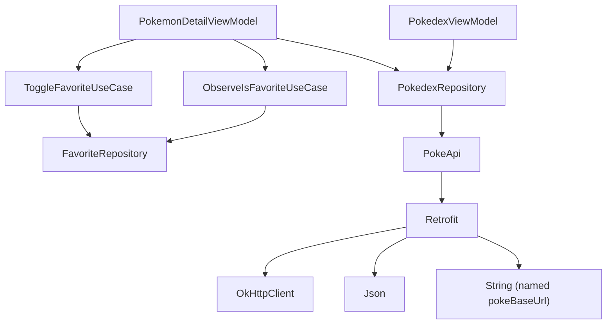

# Store – Pokédex con Koin

App Android (Jetpack Compose) con listado y detalle de Pokémon desde PokéAPI, más la función de **Pokémon favoritos**. Toda la inyección de dependencias se hace con **Koin**.

## Estructura de módulos Koin

Las definiciones están agrupadas por capa, una por archivo en `di/`:

| Módulo | Archivo | Qué registra |
|---|---|---|
| `networkModule` | `NetworkModule.kt` | `Json`, `OkHttpClient`, `Retrofit`, `PokeApi` y la URL base (con qualifier) |
| `repositoryModule` | `RepositoryModule.kt` | `PokedexRepository`, `ProductRepository`, `FavoriteRepository` |
| `useCaseModule` | `UseCaseModule.kt` | `ToggleFavoriteUseCase`, `ObserveIsFavoriteUseCase` |
| `viewModelModule` | `ViewModelModule.kt` | Todos los ViewModels |

Se cargan en `StoreApplication`.

## Grafo de dependencias



## Decisiones de ciclo de vida

| Tipo | Se usa en | Por qué |
|---|---|---|
| `single` | `Json`, `OkHttpClient`, `Retrofit`, `PokeApi`, repositorios | Son costosos de crear y deben ser compartidos. Los repositorios en memoria además **guardan estado**: si fueran `factory` cada pantalla tendría su propia copia. |
| `factory` | Casos de uso | No guardan estado y son baratos de crear. |
| `viewModel` | Todos los ViewModels | Koin los liga al `ViewModelStore` de la pantalla: sobreviven a rotaciones y se destruyen al salir de ella. |

## Qualifier

`named("pokeBaseUrl")` en `NetworkModule.kt`. Un `String` suelto es ambiguo en Koin: en cuanto otra API (por ejemplo la de auth, que ya tiene `AuthApi`) registre su propia URL base, `get<String>()` no sabría cuál devolver. El qualifier identifica cuál es.

## Pokémon favoritos

- `FavoriteRepository` (interfaz, en `domain`) con `InMemoryFavoriteRepository` (en `data`).
- `PokemonDetailViewModel` recibe los casos de uso `ObserveIsFavoriteUseCase` y `ToggleFavoriteUseCase`, no el repositorio.
- El botón de corazón está en la pantalla de detalle.
- Tests: `FavoriteUseCasesTest` verifica que marcar y desmarcar cambia el estado.

**¿Qué se comparte y durante cuánto tiempo?**
Se comparte **una única instancia** de `FavoriteRepository` (`single`) entre todas las pantallas, así que un favorito marcado en el detalle se ve en cualquier otra pantalla que lo lea. Dura mientras viva el **proceso de la app**: al cerrarla (o si Android mata el proceso) la lista se pierde, porque solo está en memoria. Para persistirla habría que cambiar la implementación (por ejemplo a DataStore o Room) sin tocar el resto del código.

## Cómo ejecutar los tests

```
./gradlew testDebugUnitTest
```

## Evidencia de ejecución

> Pendiente: agregar capturas o video de la app corriendo (listado, detalle, favorito marcado y desmarcado).
